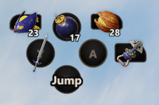
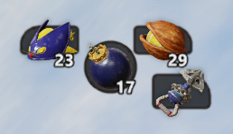
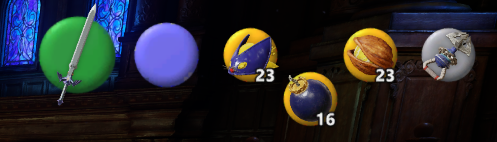

# Classic Item Slots & Smart HUD

*Code written with AI assistance (Claude Opus 5.5)*

**Classic Item Slots & Smart HUD for Ocarina of Time (Switch 2), version 1.1.1**

Default Layout

Slots Only

N64 Layout

**[Download the latest version](../../releases/latest)**: `Classic-Item-Slots-vX.zip` (Switch buttons), `-Xbox` or
`-PlayStation`. Install only one.

Legacy style item buttons: ZR plus three extra item slots (X, L, R), set separately for young and adult Link, with a
new context sensitive HUD. Removed control guides from bottom of screen.

## Features

* Now with themes and in-game customizable layout!
* Assign multiple items from Items menu: up to 3 extra item slots on L, X (or B) and R.
* Context sensitive A/ZR buttons that flip dynamically N64 style
* Removed Tutorials/Control Guides

## How to use it

Item selection is from the pause menu's Items tab like the original game. Use ZL and ZR to change tabs. Pressing A on
a highlighted item assigns it to ZR like default. Pressing X, L or R on the highlighted item assigns it to that slot.

X in the Items menu assigns to whichever button Put Away was on, so if X is your jump button it goes to B instead. For
this reason Swap Jump Controls is recommended, but it works either way.

With the Put Away button now free for an item slot, Put Away is on A when you're standing still, like the original
game. It won't happen while you're targeting with ZL, and with a bomb out A drops it instead.

All tutorial control guides are removed for cleaner look and moved to the A and ZR buttons that are context sensitive
and flip N64 style when they change. Shows ammo counts and casts left for magic spells. The pause menu shows your
assignments under the rupee counter.

## In-game editor controls (Switch)

Click both sticks together when playing or paused to enter edit mode. Controls as follows:

| Button | Does |
|---|---|
| L / R | Switch layout, currently three themes: Default button diamond, item slots only, and N64 style. |
| Left stick ← / → | Cursor selects between whole cluster or individual element |
| Left stick ↑ / ↓ | Adjust scale |
| Right stick ↑ / ↓ | Adjust opacity |
| D-pad | Adjust position |
| X | Hide/show element |
| Y | Reset element's size and position |
| Minus | Reset to default layout, hidden elements stay hidden. |
| A | Save and close edit mode |
| B | Undo changes and close edit mode. |

## Requirements

- Ocarina of Time (Switch 2), version 1.1.1
- Tested with Lichii, launching the game's .nup (booting an extracted folder won't load the mod's code and the game
  won't start)

## Install

1. Right click game > Configure game
2. Import mod from ZIP
3. Toggle it on

## Uninstall

Untick or delete the "Classic Item Slots" folder.

## Compatibility

Fog and graphics mods are fine. Mods that change the HUD or menu layouts, or the US English text, will conflict. Other
languages work, but the pause menu tab hints still show L/R.

Additional features are WIP, mod is not thoroughly tested in all scenarios. Xbox/PS layouts untested.
Planned: Incorporating edit mode into in-game options menu.

## How it was made

- `src/slots.c`, `src/hooks.S`: the mod, freestanding ARM64 C, linked by `src/link_module.ld` into its own code module
  (`exefs/subsdk9`, an NSO with a `MOD0` header, `src/module.S`) loaded right after `subsdk0`. Everything reaches the
  game through PC-relative addresses.
- `build.py`: compiles and links (LLVM: clang, ld.lld), writes the NSO and an IPS32 patch for `main` with only the
  hook points (five controller reads, the control guide and hand-state setups, the HUD and pause overlay setups, and
  the pause menu's own item assignments).
- `tools/`: the romfs side. `hud_layout.py` (with `buil.py`, a writer for the game's BFFH UI layouts) adds the HUD and
  pause-menu panes and repacks the UI archive at its exact size; `draw_buttons.py` draws the button art per theme;
  `make_icons.py` turns it into the game's BNTX textures (ASTC, with this console's block-linear layout);
  `menu_tabs.py`, `no_item_guides.py`, `hide_a_prompt.py`: the text and guide edits; `make_release.py`: the packages.
- Needs a dump of the game (1.1.1) to build the romfs files; it is only read. The tools use the zstd/SARC helpers of
  the OoT Fog Mod tools and the BYML reader of the OoT remake dev tool (paths at the top of each script).

## Credits

- Claude wrote the mod's code: the ARM64 C/assembly code module and its hooks into the game, the build scripts, and
  the tools that edit the HUD/pause-menu layouts, text and control-guide tables.
- Claude helped reverse-engineer the game (finding the functions and memory values the mod uses) from the game's code
  and live memory reads.
- The button art is drawn by a Python script Claude wrote (plain shapes and text), not by an AI image generator. Item
  icons are the game's own.
- Design, feature decisions and all in-game testing: sonofsilvanus.

Special thanks: [platinumagpie](https://github.com/platinumagpie) for [OoT Dev Tool](https://github.com/platinumagpie/oot-remake-devtool): its live connection to the game (memory reads and writes, inputs and screenshots) and its GameData readers were used throughout development and testing.
